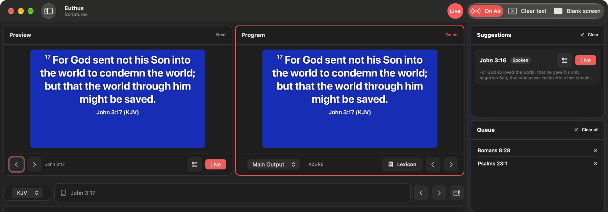
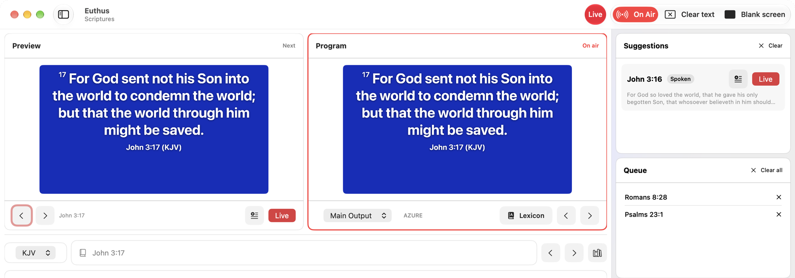
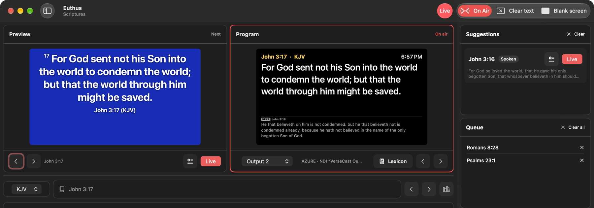

  

<h1 align="center">Euthus</h1>

  <b>Bible verses on your church screens the moment they are preached.</b> 
  A native Mac app that listens to the sermon and puts the verse up — no typing, no waiting.

  
  
  

  <a href="https://github.com/Rtnkr/euthus/releases/latest"><b>Download for Mac</b></a> ·
  <a href="#first-sunday-checklist">First Sunday checklist</a> ·
  <a href="https://github.com/Rtnkr/euthus/discussions">Feedback &amp; ideas</a> ·
  <a href="https://github.com/Rtnkr/euthus/issues/new/choose">Report a problem</a>

  

*Euthus* (Greek εὐθύς) means **"immediately"**, the word Mark uses again and again. That is the whole idea:
the preacher says *"turn with me to John 3:16"* and the verse is already on the screen.

## What it does

**Listens, so you don't have to type**
- Hears spoken references (*"Romans eight twenty-eight"*, *"Psalm 23"*, *"First Corinthians 13 verse 4"*) and shows them about a second after they are said.
- Follows along: *"verse 9"*, *"from 8 onwards"*, *"verses 10 to 13"*, *"next verse"*.
- Recognises verses that are **quoted without a reference**, and reads along as the preacher works through a chapter.
- Switches translation by voice: *"put this in Telugu"*, *"read it in the NIV"*.
- All speech recognition runs **on the Mac**. Nothing from your service leaves the building.

**Built for the person at the desk**
- Preview and Program monitors, one **Live** button (⌘↩), **Clear text** and **Blank screen** always in reach.
- Type-ahead references: start typing `joh 3 16` or `song of sol 2` and Euthus jumps there as you type.
- A short list of **suggestions** (spoken, quoted, paraphrased) you can put live with one click, plus a queue.
- Keyboard first: arrows step verses, number keys pick a verse, `L` goes live, `Tab` switches to topic search.
- Arrange the toolbar your way (right-click it → Customize Toolbar…).

**Every screen in the room**
- Up to **four outputs**: projectors, TVs, floating windows or **NDI** for your stream.
- A **confidence monitor** for the preacher: current verse, next verse, clock and sermon timer.
- **Green-key lower third** for ATEM, vMix and OBS.
- Themes with image and video backgrounds, and a **Media** folder for live backgrounds.

**More**
- Search by **topic or phrase**, e.g. *"do not worry about tomorrow"*.
- Sermon **notes and slides**, written on the Mac, exported as PDF or Markdown.
- Song lyrics, announcement slides, alerts for the nursery or car park, and a word-study lexicon.
- Phone remote and OSC control (off until you switch it on).

  
  

## Install

1. Download **Euthus-x.y.dmg** from the [latest release](https://github.com/Rtnkr/euthus/releases/latest).
2. Open it and drag **Euthus** onto **Applications**.
3. Open Euthus. The first time, macOS says it can't verify the developer:
   open **System Settings → Privacy & Security**, scroll down and click **Open Anyway**. You only do this once.

Updates arrive inside the app: **Euthus → Check for Updates…**

**Requirements:** **macOS 26 Tahoe** or later (a Mac with Apple silicon is recommended), and a microphone
or an audio feed of the preacher.

## First Sunday checklist

Do this once, a day or two before the service:

1. **Open Euthus with the internet on.** It downloads Apple's speech model in the background (once).
2. **Allow the microphone** when asked.
3. **Settings → Audio:** pick the microphone or mixer feed and press **Test microphone**. The level bar should
   move well into the middle when someone talks normally. If it barely moves, raise **Gain**. A quiet feed is the
   most common reason verses appear slowly.
4. **Outputs…** (sidebar): choose the projector and, if you stream, an NDI or green-key output.
5. **Add your Bibles** (optional): Euthus includes the King James Version. See [Bibles](#bibles).
6. Press **Listen**, read a verse out loud, and watch it appear.

## Bibles

Euthus includes the public-domain **King James Version**, ready to use.

To add more translations, put Bible files in **Documents › Euthus Bibles** (or choose any folder in
**Settings → Scripture**). Euthus reads **Zefania XML**, **OpenSong XML** and **MyBible (.SQLite3)** modules, including
Telugu and other non-English Bibles. If a file can't be read, Settings says which one.

Please use only translations your church is licensed to use. Euthus does not supply copyrighted translations.

## Feedback

This is a young app, and your feedback shapes it.

- 💬 **Ideas, questions, "how do I…"** → [Discussions](https://github.com/Rtnkr/euthus/discussions)
- 🐞 **Something went wrong** → [Report a problem](https://github.com/Rtnkr/euthus/issues/new/choose).
  If it is about detection, please attach the log: in Finder press ⇧⌘G and open `~/Library/Logs/Euthus.log`.

## Privacy

Euthus has no account, no analytics and no tracking. Speech is recognised on your Mac and stays there.
The app goes online only to download Apple's speech model, to check GitHub for updates, and to talk to the
devices *you* connect (NDI, linked Macs, phone remote). Details: [PRIVACY.md](PRIVACY.md).

## License

Euthus is **free to download and use** in any church, ministry or home.
It is **not open source**: the app, its name and its design are © Ratnakar Boddu, all rights reserved.
You may not copy, modify, redistribute, sell, or present Euthus as your own work. See [LICENSE.md](LICENSE.md).

Made for the local church. Soli Deo gloria.

